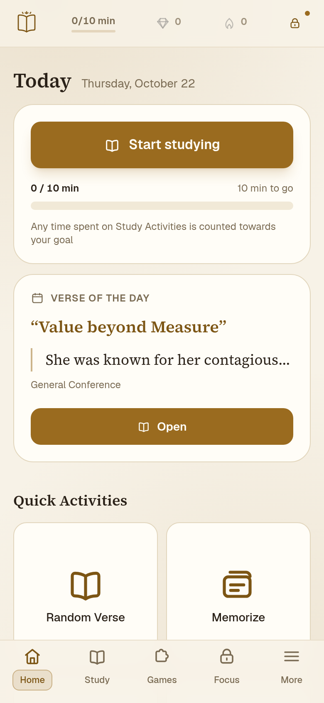
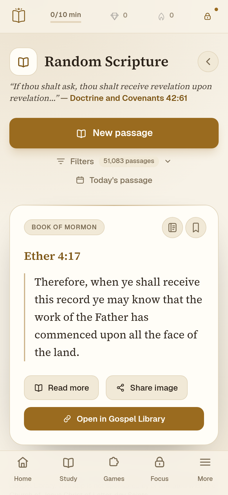
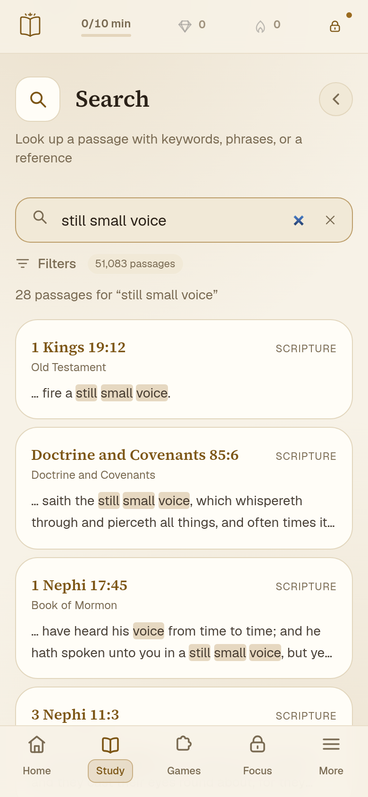
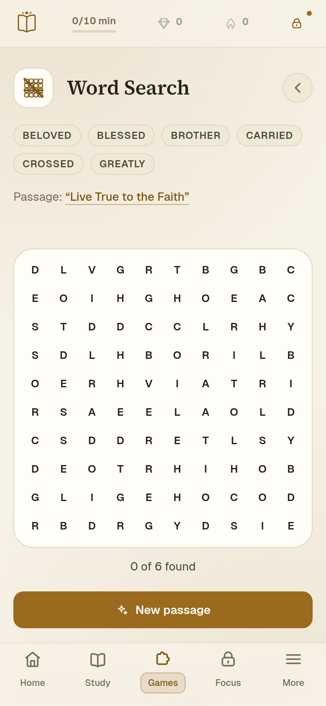
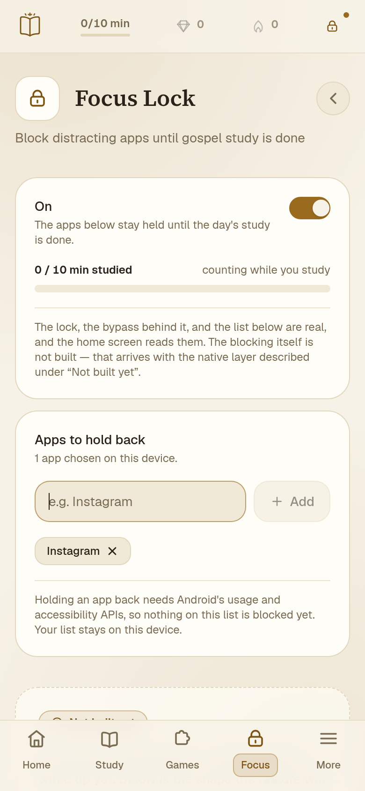
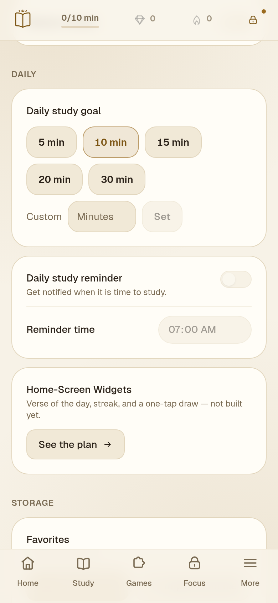

# Gospel Focus 📖

A random scripture finder for the **Standard Works** and **General Conference** of
The Church of Jesus Christ of Latter-day Saints — and a small daily study app
built around whatever passage it draws.

> Not sponsored by or affiliated with The Church of Jesus Christ of Latter-day
> Saints.

| Home | Reading | Search |
| --- | --- | --- |
|  |  |  |

| Word search | Focus | Settings |
| --- | --- | --- |
|  |  |  |

## Why

Growing up, when I needed some inspiration or wanted to pray for guidance from the
Lord, I would open my scriptures to a random page and scan through the verses.
Many times I found something that felt especially relevant to my situation.
Moments like that made me feel seen and known by my Savior.

Since then, phones and the internet have largely replaced my use of physical
books. Having any scripture or talk available wherever I go has been a blessing,
but I missed the novelty of the "open to a random page" approach.

_**Gospel Focus**_ pulls passages from all LDS standard works and general
conference talks, rifles through virtual pages, and lands on one. You can read the
whole chapter, open it in the Church's Gospel Library, hide the words and recite
them, write a note, or star it for later — and the app counts the time spent doing
it, so a day's study becomes a streak.

## What you can do

**Read**

- Draw a random passage, weighted across every selected source.
- Filter by volume and book, by conference, or with one-tap presets.
- Riffle through pages as the passage is chosen; *Reduce motion* skips it.
- Expand to the whole chapter or talk, with the drawn verse marked.
- Tap verses to share them as images, favorite them, memorize them, or take a
  note.
- Open any passage in the Gospel Library app on Android.

**Build a habit**

- A verse of the day, seeded from the date so the app and the reminder agree.
- A daily goal of 5–30 minutes, timed automatically while you study.
- A streak of days the goal was met, with up to two freezes to protect it.
- A daily reminder as a native notification, scheduled ahead and offline.
- Gems, freezes, and a shop.

**Study**

- Search every verse and conference paragraph at once, offline.
- Build memory decks, hide words, and run two-sided flashcards.
- Write journal entries and notes linked to passages, or to each other.
- See your streak, minutes, passages, puzzles, and recitations on the stats page.

**Play**

- *What's That Verse?* — name the reference, with hints you buy with gems.
- A daily word puzzle hidden in the day's chapter.
- A ten-by-ten word search built from the passage's own words.

**Focus**

- Set up the Focus Lock, pick the apps to disable from the ones on your phone,
  and see today's minutes against the goal.
- Take a hand bypass for 15 minutes, 30 minutes, or the rest of the day.
- On Android, a lock screen covers those apps until the day's study is done. It
  needs Android's accessibility access, sees only which app is in front, and
  reads nothing on your screen. It is drawn inside the system bars, so the home
  button and the home gesture always work and are always a way out — and however
  you leave it, it stays down. iOS and the web keep the lock's state but do not
  block.

**Make it yours**

- Light, dark, or follow the system; Focused or Playful style; reduced motion.
- Everything is local. No account, no ads, no analytics.

## Free

Everything in the app is free today, and nothing is gated. Nothing is for sale.

## Install

**Android** — download the signed APK from the
[Releases](https://github.com/bdgcypher/gospel-focus/releases) page and open it on
your phone. Android will ask you to allow installs from that source once. Every
tagged release installs over the previous one. Once installed, the app checks for
a newer release when it starts and every eight hours after that, and offers it
with a notification; tapping the notification downloads the APK and opens
Android's installer.

**Web** — `npm run build` exports the same app into `out/`; serve it with
`npm run preview`. There is no hosted instance yet.

**iOS** — the project builds for the simulator on a Mac (`npm run ios:build`).
There is no signed IPA or App Store build.

Build prerequisites, signing, CI, and the data pipeline are in
[CONTRIBUTING.md](CONTRIBUTING.md).

## Privacy

The app runs entirely on your device. Favorites, notes, study minutes, streaks,
decks, and settings live in local storage; nothing is uploaded, and there is no
account or analytics. The only thing that leaves the app is a passage you choose
to open in the Gospel Library, and the reminder is scheduled locally.

## Data & attribution

Passage text is bundled so the app works offline: 41,995 scripture verses and
9,088 general conference paragraphs, 51,083 passages in all.

- **Scripture** — [bcbooks/scriptures-json](https://github.com/bcbooks/scriptures-json),
  public domain, 2013 edition.
- **General conference** — [johnmwood/LDS-Conference-Scraper](https://github.com/johnmwood/LDS-Conference-Scraper).
  The source declares no license; the text is included for personal study and
  **redistribution rights must be confirmed before publishing**. See
  [PROJECT_OVERVIEW.md](PROJECT_OVERVIEW.md#two-gates-that-shape-everything).

Every passage links back to the Church's official Gospel Library. This project is
not affiliated with or endorsed by the Church.

## Development

```bash
npm install
npm run dev        # http://localhost:3000
npm run typecheck  # generate route types, then tsc --noEmit
npm run lint       # eslint
npm run build      # static export into ./out
```

`npm run bootstrap` provisions Node-side prerequisites, the JDK, and the Android
SDK, then installs and builds. The scripts, native projects, data generation, and
release flow are documented in [CONTRIBUTING.md](CONTRIBUTING.md).

The plan, the feature catalog, the paywall boundary, and the design tokens are in
[PROJECT_OVERVIEW.md](PROJECT_OVERVIEW.md). The status of every destination in the
app comes from `lib/features.ts`.
